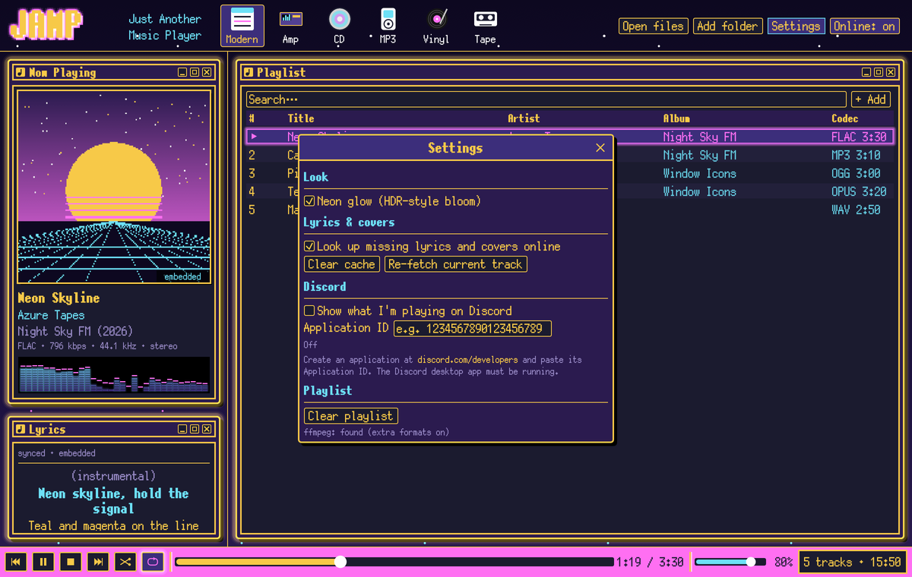

# JAMP — Just Another Music Player

JAMP is a lightweight desktop music player written in Rust. It pairs a foobar2000-style
playlist with a set of skins that turn the player into a piece of animated hardware: a CD
that spins, a turntable whose tonearm moves across the record as the song plays, a cassette
whose tape winds from one reel to the other, and more.

It plays nearly every audio format, shows time-synced lyrics, and fetches missing lyrics and
cover art from free online sources, but only when a file doesn't already have them.


## Highlights

- **Six skins**: Modern, Amp, CD, MP3, Vinyl and Tape. Each is drawn live with moving parts.
- **Plays almost anything**: MP3, FLAC, WAV, OGG, AAC/M4A, ALAC, AIFF and more built in, plus
  Opus, WMA, APE, WavPack, DSD and others when [ffmpeg](https://ffmpeg.org/) is installed.
- **Synced lyrics and cover art**: read from the file first, fetched online only when missing.
- **Any language**: Japanese, Chinese, Korean, Cyrillic, Greek, Thai, Arabic, Hebrew and more,
  with right-to-left text laid out correctly.
- **Discord Rich Presence**: optional "Listening to …" status with a progress bar.
- **Portable**: a single executable that can keep all of its data in a folder next to itself.
- **Small**: one ~11 MB executable; no installer, no runtime to install.

## Skins

Switch skins with the icons along the top of the window. JAMP remembers the last one used.

| | |
|---|---|
| **Modern**: a foobar-style playlist with cover art, track details, synced lyrics and a spectrum analyser. | **Amp**: a late-90s desktop amp with a seven-segment time display, a spectrum/oscilloscope (click to switch), a scrolling title and a playlist editor. |
|  |  |
| **CD**: a portable CD player. The album cover is printed on the disc, which spins while playing; the lid opens when nothing is loaded. | **MP3**: a pocket player with a screen and a click wheel. Drag around the wheel to change the volume. |
|  |  |
| **Vinyl**: a turntable. The platter speeds up and slows down gradually, the cover is the record label, and the tonearm follows the song. Click anywhere on the record to jump there. | **Tape**: a cassette deck. Tape winds from the left reel to the right as the song plays, the emptier reel spins faster (as on a real cassette), with VU meters, a tape counter and piano-key controls. |
|  |  |

## Features

### Playback

- Built-in pure-Rust decoders ([Symphonia](https://github.com/pdeljanov/Symphonia)) handle
  MP3, MP2, FLAC, WAV, OGG Vorbis, AAC/M4A, ALAC, AIFF, CAF, MKA/WebM and ADPCM.
- If [ffmpeg](https://ffmpeg.org/) is on your `PATH` or sitting next to the JAMP executable,
  JAMP uses it for everything else: Opus, WMA, APE, WavPack, TTA, AC3, DSD and more.
- Playlist with search, drag and drop of files and folders, `.m3u`/`.m3u8` import, shuffle,
  repeat all / repeat one, and the playlist restored on the next launch.
- Spectrum analyser and oscilloscope driven by the audio actually playing.
- JAMP always starts at 5% volume, so it never blasts at launch.

### Lyrics and cover art

JAMP looks for lyrics and cover art in this order and stops at the first hit:

1. **Inside the file**: embedded lyrics and pictures in the tags.
2. **Next to the file**: `song.lrc` / `song.txt` for lyrics; `cover.jpg`, `folder.png`,
   `front.jpg` and similar for art.
3. **Local cache**: results from earlier online lookups.
4. **Online**, only if steps 1–3 found nothing:
   - lyrics from [LRCLIB](https://lrclib.net/). When they're time-synced, the current line is
     highlighted and the lyrics scroll along with the song.
   - cover art from the iTunes Search API, then [MusicBrainz](https://musicbrainz.org/) and the
     [Cover Art Archive](https://coverartarchive.org/).

Online lookups send only the artist, title, album and track length; audio files never leave
your computer. Each song is looked up once and the result, including "not found", is cached.
Online lookups can be turned off entirely.

### Languages

- Japanese (kana and about 6,000 kanji) is drawn in the same pixel font as the rest of the UI.
- Chinese, Korean, Thai, Cyrillic, Greek, Arabic, Hebrew, Devanagari and other scripts use
  fonts already installed on your system. They're memory-mapped, so they add almost nothing to
  memory use.
- Arabic, Persian and Hebrew are joined and laid out right-to-left.
- Known limitation: scripts that combine letters into complex clusters (such as some Indic
  conjuncts) are only approximated, because the UI toolkit has no full text shaper.

### Look

- Pixel-art styling based on the design of [The1Azreen's personal site](https://the1azreen.neocities.org/):
  the PixelMplus12 font, a slowly scrolling starry night-sky background, yellow-bordered
  windows that light up teal on hover, and a magenta taskbar.
- Optional **neon glow**: a soft bloom around borders, the logo, LCD digits, spectrum bars and
  the spinning media.

## Getting started

JAMP is built from source with a recent stable [Rust toolchain](https://rustup.rs/):

```sh
git clone https://github.com/The1Azreen/Just-Another-Music-Player.git
cd Just-Another-Music-Player
cargo build --release
```

The player is then at `target/release/jamp.exe` (`target/release/jamp` on Linux/macOS). Run
it, then drop music files or folders onto the window, or use **Open files** / **Add folder**.

JAMP is developed and tested on Windows 11. The code is cross-platform and should also build
on Linux and macOS, but those builds haven't been tested. On Linux you'll need the usual audio
and windowing development packages, e.g. `libasound2-dev`, `libxkbcommon-dev` and
`libgtk-3-dev` (for the file dialogs).

On Windows, the release build links the C runtime statically, so the `.exe` runs on any machine
without installing anything. The app icon is embedded when the Windows SDK's `rc.exe` is
available.

### Portable mode

By default JAMP stores its settings, playlist and lyrics/cover cache in your user profile.
To keep everything next to the executable instead (for example on a USB stick), either:

- rename the executable so its name contains `portable` (e.g. `portable.exe`), or
- create an empty folder named `jamp-data` next to the executable.

JAMP will then use that `jamp-data` folder for all of its data.

## Using JAMP

### Playlist

- Double-click a track to play it; right-click for **Play**, **Remove** and **Show in folder**.
- Type in the search box to filter by title, artist or album.
- **Clear** empties the playlist. Click it once to arm it, then again within 3 seconds to confirm.

### Keyboard shortcuts

| Key | Action |
|---|---|
| Space | Play / pause |
| ← / → | Seek back / forward 5 seconds |
| ↑ / ↓ | Volume up / down |
| N / B | Next / previous track |
| Enter | Play the selected track |
| Delete | Remove the selected track |
| Ctrl+O | Open files |

### Settings



Open **Settings** from the top-right of the window.

- **Look**: turn the neon glow on or off.
- **Lyrics & covers**: turn online lookups on or off, clear the cache, or re-fetch the current
  track's lyrics and cover.
- **Discord**: show what you're listening to on your Discord profile (see below).
- **Playlist**: clear the playlist, and check whether ffmpeg was found.

### Discord Rich Presence

JAMP can show "Listening to" on your Discord profile with the track title, artist, album and a
progress bar. When the cover art came from the internet it's shown too; otherwise the JAMP icon
is used. It's off by default and needs a one-time setup:

1. Open the [Discord Developer Portal](https://discord.com/developers/applications) and click
   **New Application**. The name you choose (e.g. "JAMP") is what Discord displays.
2. Copy the **Application ID** from the application's *General Information* page.
3. In JAMP, open **Settings**, paste the ID into **Application ID**, and tick
   **Show what I'm playing on Discord**.

The Discord desktop app has to be running. JAMP connects in the background, reconnects if
Discord restarts, and shows the connection status under the ID field.

### Tip: Windows Auto HDR

JAMP renders in standard dynamic range. On an HDR display, Windows **Auto HDR** can upgrade it
so the neon colours appear brighter. Windows only applies Auto HDR to apps it treats as games,
and decides that per executable, so it may need enabling once: while JAMP is running, press
**Win+G** and tick **Remember this is a game** in the Game Bar settings, or turn on Auto HDR
for the JAMP executable under *Settings › System › Display › Graphics*. Because the setting
is tied to the file's location, it has to be done again if the executable is moved.

### Command line

```
jamp [FILES/FOLDERS/PLAYLISTS...] [options]

  --skin <modern|amp|cd|mp3|vinyl|tape>   start with this skin
  --seek <seconds>                         start the first track at this position
  --fresh                                  ignore and don't save the previous session
  --settings                               open the settings window at start
  --screenshot-dir <dir>                   screenshot every skin into <dir> and quit
```

## Development

Run the tests with `cargo test`. The tests that use the network or need sample audio are
opt-in:

```sh
JAMP_TEST_MUSIC=/path/to/music cargo test -- --ignored
```

The screenshots in this README were generated with `--screenshot-dir`, using demo tracks
synthesized for the purpose; their artists, songs, lyrics and cover art are made up.

```
src/
  main.rs       command line, window setup, portable mode
  app.rs        app state, playlist, panels, settings, animation physics
  audio.rs      Symphonia / ffmpeg decoding, audio output, visualiser feed, FFT
  meta.rs       tag reading (lofty), embedded and local covers/lyrics
  online.rs     LRCLIB / iTunes / MusicBrainz lookups and the disk cache
  discord.rs    Discord Rich Presence over Discord's local IPC pipe
  lyrics.rs     plain and LRC (time-synced) lyrics parsing
  theme.rs      palette, fonts and system font fallbacks, RTL text, background, glow
  skins/        modern, amp, cd, mp3, vinyl, cassette
```

## Credits

- Visual design based on [The1Azreen's personal site](https://the1azreen.neocities.org/).
- Font: PixelMplus12 by itouhiro, under the [M+ FONT LICENSE](assets/fonts/LICENSE-MPLUS.txt).
- Lyrics from [LRCLIB](https://lrclib.net/); cover art from the iTunes Search API,
  [MusicBrainz](https://musicbrainz.org/) and the [Cover Art Archive](https://coverartarchive.org/).
- Built with [egui/eframe](https://github.com/emilk/egui),
  [Symphonia](https://github.com/pdeljanov/Symphonia), [rodio](https://github.com/RustAudio/rodio)
  and [lofty](https://github.com/Serial-ATA/lofty-rs).
