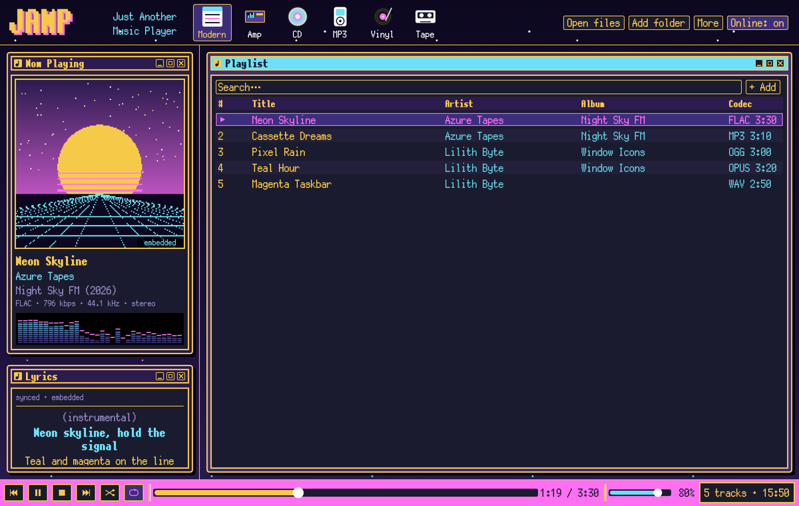
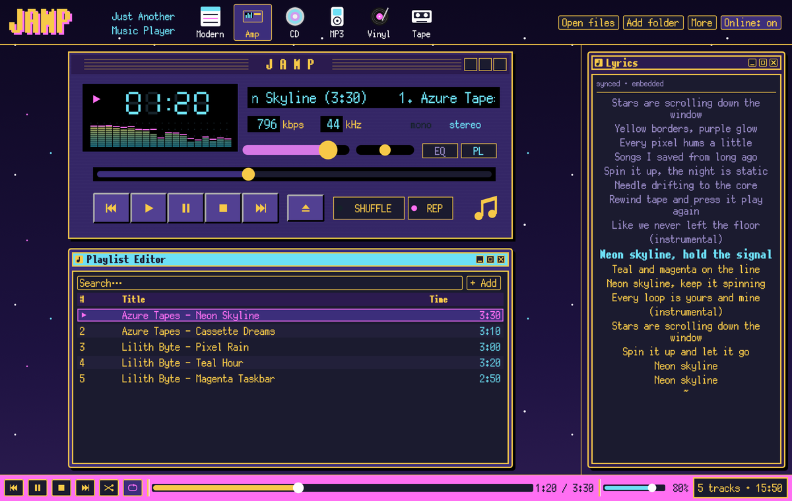
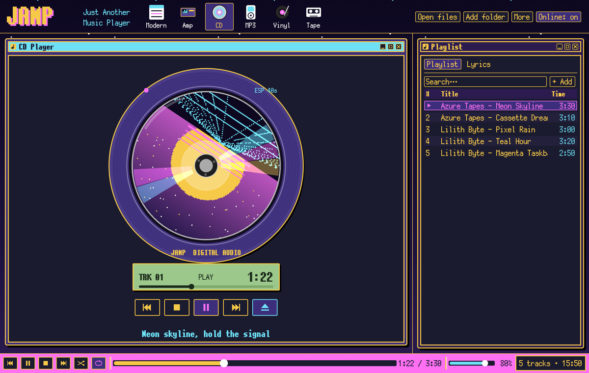
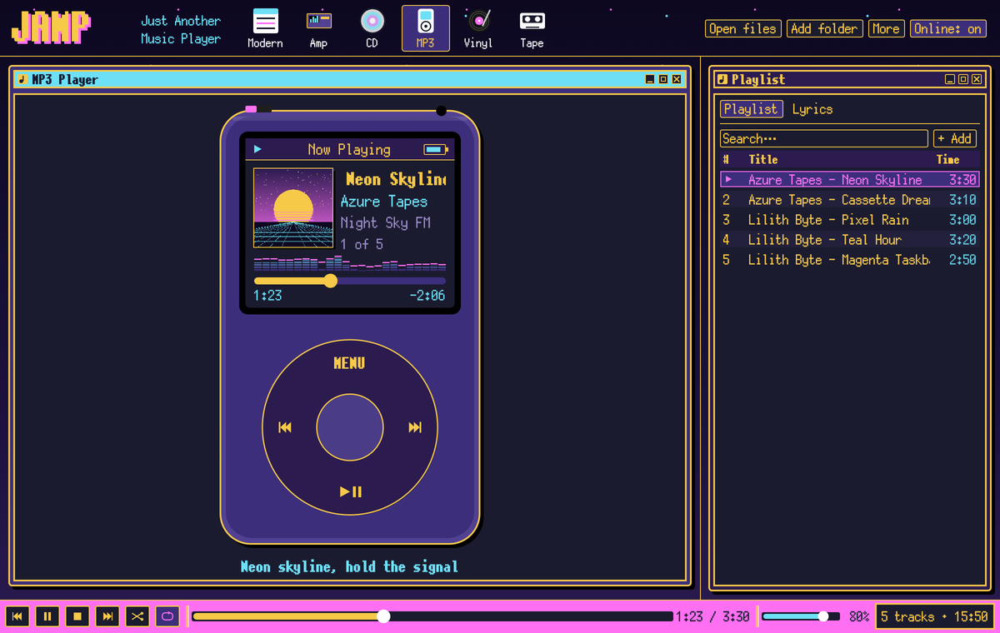
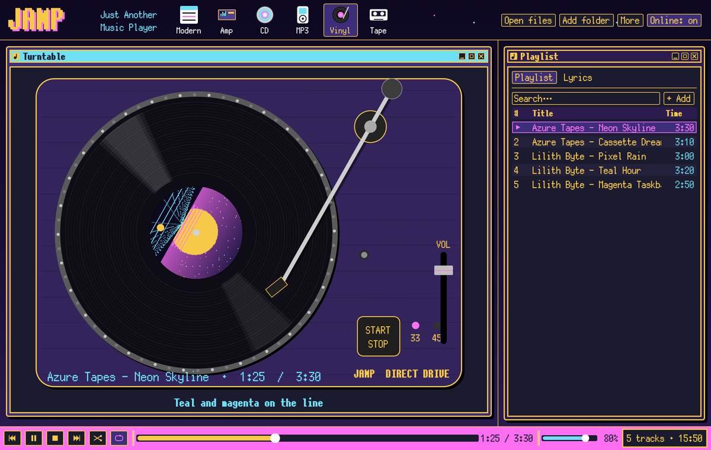
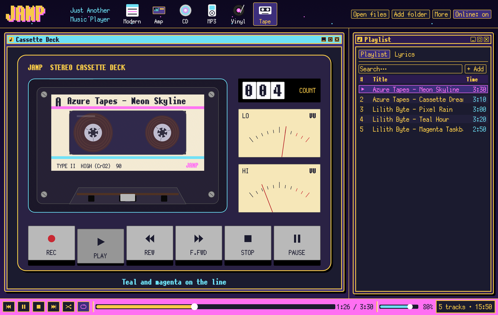

# JAMP — Just Another Music Player

A lightweight, foobar-style music player written in Rust, dressed in the night-sky / neon-window
theme of [the1azreen.neocities.org](https://the1azreen.neocities.org/). Pick a skin and the
player turns into a different piece of hardware with moving parts: a spinning CD, a turntable
whose tonearm tracks across the record, a cassette whose tape winds from reel to reel.



## Skins

| | |
|---|---|
| **Modern**: foobar-style playlist, cover, synced lyrics, spectrum | **Amp**: late-90s desktop amp with seven-segment LCD, spectrum/oscilloscope, playlist editor |
|  |  |
| **CD**: portable CD player; the cover is printed on the spinning disc | **MP3**: pocket player with a click wheel (drag around it for volume) |
|  |  |
| **Vinyl**: platter spins up/down with inertia, tonearm follows the song, click the record to drop the needle | **Tape**: reels turn at constant tape speed, tape moves from one pack to the other, VU meters and a tape counter |
|  |  |

Switch skins with the icons in the header. The choice is remembered.

## Features

- **Plays almost anything.** Built-in pure-Rust decoders (Symphonia) cover MP3, MP2, FLAC,
  WAV, OGG Vorbis, AAC/M4A, ALAC, AIFF, CAF, MKA/WebM and ADPCM. With
  [ffmpeg](https://ffmpeg.org/) installed (on `PATH` or next to the exe), JAMP falls back to it
  for everything else: Opus, WMA, APE, WavPack, TTA, AC3, DSD and more.
- **Lyrics and covers, only when missing.** Embedded tags win, then local files
  (`song.lrc` / `song.txt`, `cover.jpg` / `folder.png` / `front.*`). Only if neither exists does
  JAMP go online:
  - lyrics from [LRCLIB](https://lrclib.net/) (time-synced when available; the current line is highlighted and auto-scrolls)
  - covers from the iTunes Search API, then [MusicBrainz](https://musicbrainz.org/) + [Cover Art Archive](https://coverartarchive.org/)

  Results (and misses) are cached, so each song is looked up once. Toggle with **Online: on/off**.
- Playlist with search, drag & drop of files and folders, `.m3u`/`.m3u8` import, shuffle,
  repeat all/one, and session restore.
- Spectrum analyser and oscilloscope fed from the actual audio.
- Your site's look: PixelMplus12 font, scrolling star background ported from the site's CSS,
  yellow-bordered windows that light up teal on hover, magenta taskbar.

## Download / portable use

`release/portable.exe` is a single self-contained Windows executable with no installer and no
VC++ runtime needed. Because its name contains "portable", it keeps settings, playlist and the
lyrics/cover cache in a `jamp-data` folder next to itself, so the folder can live on a USB stick.

Any build of JAMP becomes portable if you create a `jamp-data` folder next to the exe. Otherwise
settings go to the normal per-user app-data location.

## Keyboard

| Key | Action |
|---|---|
| Space | Play / pause |
| ← / → | Seek −5 s / +5 s |
| ↑ / ↓ | Volume |
| N / B | Next / previous |
| Enter | Play selected track |
| Delete | Remove selected track |
| Ctrl+O | Open files |

Double-click a playlist row to play it; right-click for more.

## Building

Requires a recent stable Rust toolchain.

```sh
cargo run --release -- "path/to/music"
```

On Windows the build embeds the app icon when the Windows SDK's `rc.exe` is available and links
the C runtime statically (see `.cargo/config.toml`). On Linux you'll need the usual
ALSA/X11/Wayland development packages (`libasound2-dev`, `libxkbcommon-dev`, `libgtk-3-dev` for the
file dialogs).

Command-line options:

```
jamp [FILES/FOLDERS/PLAYLISTS...] [options]
  --skin <modern|amp|cd|mp3|vinyl|tape>   start with this skin
  --seek <seconds>                         start the first track at this position
  --fresh                                  ignore and don't save the previous session
  --screenshot-dir <dir>                   screenshot every skin into <dir> and quit
```

The screenshots above were made with `--screenshot-dir`, using demo tracks synthesized for the
purpose (the artists, songs, lyrics and cover art are made up).

Tests: `cargo test`. The network and format tests are opt-in:
`JAMP_TEST_MUSIC=/some/folder cargo test -- --ignored`.

## Project layout

```
src/
  main.rs       CLI, window setup, portable mode
  app.rs        state, playlist, panels, animation physics
  audio.rs      Symphonia/ffmpeg decoding, rodio output, visualiser tap, FFT
  meta.rs       tags (lofty), embedded/local covers and lyrics
  online.rs     LRCLIB / iTunes / MusicBrainz lookups + disk cache
  lyrics.rs     plain + LRC parsing
  theme.rs      site palette, fonts, night sky, window frame, drawing helpers
  skins/        modern, amp, cd, mp3, vinyl, cassette
```

## Credits

- Font: PixelMplus12 by itouhiro, [M+ FONT LICENSE](assets/fonts/LICENSE-MPLUS.txt)
- Lyrics: [LRCLIB](https://lrclib.net/) · Covers: iTunes Search API, MusicBrainz, Cover Art Archive
- Built with [egui/eframe](https://github.com/emilk/egui), [Symphonia](https://github.com/pdeljanov/Symphonia), [rodio](https://github.com/RustAudio/rodio), [lofty](https://github.com/Serial-ATA/lofty-rs)
